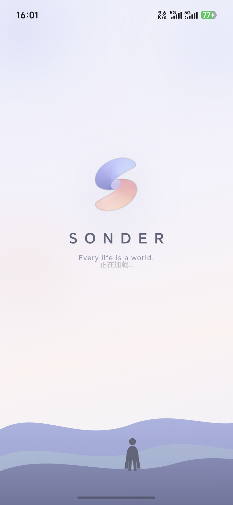
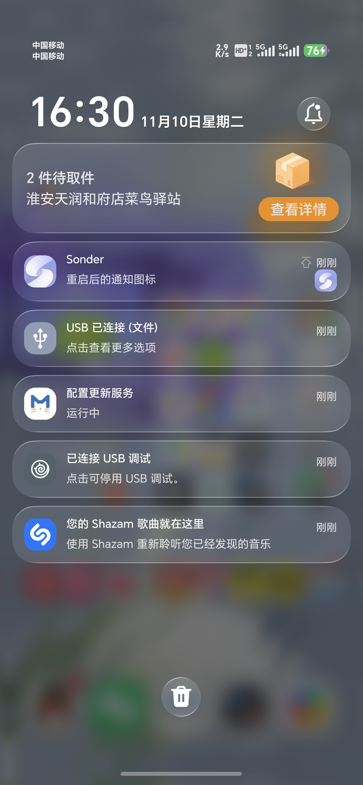

# Sonder 品牌与客户端说明

> 版本：4.1.2（2026-11-10）· 适用：Web / PWA / Android
> 本文记录 Sonder 的命名、图标、开屏与通知方案，以及对应的代码位置和真机验证结果。

---

## 1. 命名

| 项目 | 内容 |
|---|---|
| 产品名 | **Sonder** |
| Slogan | **Every life is a world.** |
| 含义 | 每一个擦肩而过的陌生人，都拥有和你一样复杂、鲜活的一生——这也是产品里「AI 人物在真实生活」的由来 |
| 包名 / 原生桥 | 保持 `com.speakeasy.app` / `SpeakEasyNative` 不变（兼容已安装数据、推送注册与接口身份） |
| 仓库名 | 仍为 `speakeasy`（历史命名，不影响品牌） |

已统一的品牌露出：桌面名称、任务标题、网页 `<title>`、PWA `manifest`、关于页、通知标题、通话通知文案、通知渠道描述、设计验收页标题。

<p align="center">
  
</p>

---

## 2. 图标

### 2.1 三版素材与用途

| 版本 | 用途 |
|---|---|
| **Light**（白底 + 彩色 S） | 浅色模式下的桌面图标 |
| **Dark**（深底 + 彩色 S） | 深色模式下的桌面图标 |
| **Dynamic**（紫蓝渐变 + 白色 S） | 通知栏图标、PWA / favicon、应用商店与安装器展示 |

### 2.2 桌面图标随明暗切换

- 实现：两个 `activity-alias`（`.LauncherLight` / `.LauncherDark`）指向同一个 `MainActivity`，任一时刻只启用一个；
- 切换：`LaunchIcon.apply(context)` 在进程启动和 `onConfigurationChanged`（`uiMode` 已在 `configChanges` 中）时，以 `DONT_KILL_APP` 启用目标 alias、禁用另一个；
- Android 13+：额外提供 `<monochrome>` 层，系统开启「主题图标」时跟随壁纸着色；
- 真机验证：浅色 `enabledComponents = LauncherLight`，切深色后 `enabledComponents = LauncherDark`（Honor MEP-AN00 / Android 17）。

代码位置：

```
mobile/android/app/src/main/AndroidManifest.xml        # alias 与 LAUNCHER intent-filter
mobile/android/app/src/main/java/com/speakeasy/app/LaunchIcon.java
mobile/android/app/src/main/res/mipmap-anydpi-v26/     # ic_launcher_light.xml / ic_launcher_dark.xml
mobile/android/app/src/main/res/mipmap-anydpi-v33/     # 含 <monochrome>
mobile/android/app/src/main/res/mipmap-*/              # 对应密度 PNG
```

### 2.3 通知图标

Android 原生通知分两个位置：

| 位置 | 内容 | 实现 |
|---|---|---|
| 通知栏左侧 | **Dynamic 渐变图标**（国产 ROM 显示的是应用图标） | 应用图标为 Dynamic；JPush 通知按同名资源读取 `jpush_notification_icon` |
| 通知栏右侧 | **发消息的 AI 头像**；没有头像的互动/系统通知回退 Dynamic 渐变图 | 后端 `large_icon` 指向 `/api/v3/avatar/<seed>.png`，无头像时回退 `/icons/brand-512.png` |
| 状态栏小图标 | 单色 S 剪影（系统会强制单色，彩色渐变会变白方块） | `res/drawable-nodpi/jpush_notification_icon.png`，本地通知同用 |

> 国产 ROM（Honor / Huawei）会把**旧应用图标缓存**在系统里，换图标后首次可能仍显示旧 logo；升级版本 + 重启设备即可刷新（本版本已实测）。



---

## 3. 开屏

### 3.1 方案

1. **Android 12+ 系统启动屏**：只保留品牌底色（`windowSplashScreenBackground = #F3F1FA` / 深色 `#12131B`），把 `windowSplashScreenAnimatedIcon` 设为全透明——避免系统在白底上画出一个「白底方图标」；
2. **品牌开屏**：静态导出的 `index.html` 内联注入（先于任何 CSS 生效）：渐变夜空 + 柔光色块 + S 标 + `SONDER` + `Every life is a world.` + 山丘/人影剪影；
3. **淡出**：React 挂载或 `load` 后淡出（最短展示约 1.15s，5s 兜底）；原生启动主题背景色与 WebView 底色同色，避免白屏闪烁。


### 3.2 代码位置

```
frontend/src/app/layout.tsx        # SPLASH_CSS / SPLASH_SCRIPT / #sonder-splash 标记
frontend/src/w4/App.tsx            # 挂载后调用 window.__hideSonderSplash()
mobile/android/app/src/main/res/values/styles.xml        # AppTheme.NoActionBarLaunch
mobile/android/app/src/main/res/values/splash_colors.xml  # 浅色品牌底色
mobile/android/app/src/main/res/values-night/splash_colors.xml
mobile/android/app/src/main/res/drawable/splash_empty.xml # 透明系统启动图标
frontend/public/icons/sonder-mark.png
```

---

## 4. 真机验证

设备：**Honor MEP-AN00 · Android 17（API 37）**，release 签名包（versionCode 412）。

| 项目 | 结果 |
|---|---|
| 桌面名称 | `aapt2 dump badging` → `application-label:'Sonder'` |
| 浅色 / 深色图标 | `enabledComponents` 分别为 `LauncherLight` / `LauncherDark` |
| 系统启动屏 | 逐帧截图无白底方图标，品牌底色 → 渐变开屏 → 应用 |
| 通知（无头像） | 左侧 Dynamic、右侧 Dynamic 兜底，标题/内容正常 |
| 通知（聊天消息） | 左侧 Dynamic、右侧 AI 头像 |
| 推送注册 | `SpeakEasyPush: registered id=…`，设置页显示「已开启，推送已注册。」 |

---

## 5. 素材说明

当前图标与开屏是按用户提供的设计稿截图（logo 拼图 455×169、开屏 mockup 285×440）重建/放大生成的；桌面小尺寸与通知场景效果正常，但大尺寸展示会略软。若拿到原始 **SVG / 1024×1024 PNG / Figma 源文件**，替换以下目录即可获得矢量清晰版：

```
frontend/public/icons/                            # Web / PWA
mobile/android/app/src/main/res/mipmap-*/         # Android 各密度
docs/screenshots/sonder-splash.png 等              # 文档配图（可选）
```

---

## 6. 版本记录

| 版本 | 变更 |
|---|---|
| 4.1.1 | 真机 9 项问题修复、JPush 注册修复、通知头像与内容、tab 切换闪光修复 |
| 4.1.2 | 品牌升级：Sonder 命名、明暗主题桌面图标、Dynamic 通知图标、品牌开屏、系统启动屏去图标；通知栏左侧图标缓存问题修复（版本升级 + 重启刷新） |
