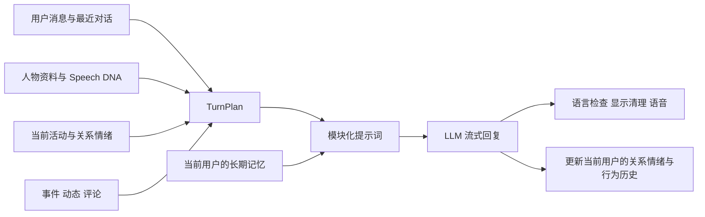

# 人物聊天与动态真实感审计

审计日期：2026-11-13。本文记录本轮代码审计与已落地修改，不把离线测试通过等同于真实模型已经达到高拟真。

## 结论

原有系统已经有结构化人物、Speech DNA、生活事件、情绪、关系和记忆，并非只有一段角色提示词。主要问题是这些层有时互相抢控制权：行为引擎把“倾向”变成每轮动作，文风要求把不同人物推向相同的短句/玩笑/追问，发帖有多条独立提示词，生活事实又因预算和时间处理被丢失或说错。

本轮改动把“先接住对方这句话”放回聊天中心，允许安静、普通、没有结尾升华的表达；公开动态按人物自己的社交账号写作；人物经历保留来源、时间与计划/完成区别。不会为营造真人感而在被直接问身份时否认 AI 身份。

## 消息是怎样回复的

主要入口在 `backend/app/v2/chat_service.py`。文字回复和通话均经 `backend/app/v3/prompt_composer.py`，人物状态由 `backend/app/v3/persona_context.py` 构造。

`TurnPlan` 包含人物资料、DNA、情绪、行为倾向、少量示例、生活事实和本轮时间。行为选择是规则计算，不额外调用模型。长期记忆由 `v2/memory.py` 管理，用户与人物的私聊情绪单独保存，公共世界情绪不被某个用户的私聊覆盖。

真正进入聊天的生活事实入口是 `event_posts.persona_recent_facts`，不仅是 `life_events.event_fact_block`。它读取本人参与过的事件、下一条计划、本人最近动态、动态下的评论，再交给 composer 裁剪。这两条事实格式化路径都需要时间保护，不能只修一处。

本轮聊天改动包括：

- 将行为指令降为可忽略的倾向，用户的实际消息优先。提问按需要发生，不强制每轮追问，也不按行为枚举机械禁止合理澄清。
- 表达长短跟随内容和人物，取消清理阶段的 420 字符二次截断，避免回答在否定词、解释或关键信息前被截掉。
- DNA 是习惯，不要求每句话都展示幽默、口头禅或热情；示例用于语感参考，不是新的亲身经历。
- 离线 mock 优先回应打招呼、告别、坏消息、好消息、直接问题和身份问题；删除部分凭空经历。mock 仍是模板降级，不能用于证明真实模型质量。
- 情绪可以自然影响说话方式；别人询问近况时可以说累，不再被“不得说明情绪”的绝对指令拦住，也不能凭空编原因。
- 通话压缩器兼容新的“问题可选”“用户实际消息优先”指令，防止短提示词丢失关键语义。

## 动态是怎样产生的

动态不是单一路径，至少需要同时审计下列来源：

| 路径 | 输入与作用 | 本轮处理 |
| --- | --- | --- |
| `daily_world.py`、`world.py` | 新人物及初始化动态 | 人物职业、地点、兴趣与经历相互一致；不再统一温和幽默；避免咖啡/书/下雨同一套文案 |
| `life_events.py` → `event_posts.py` | 生活事件推进后，参与者各自公开表达 | 增加近期生活连续性；共享事件事实；不同人物使用自己的表达习惯 |
| `life_posts.py` | 人物、图库素材、生活图文 | 素材作为观察对象，不能仅凭图片标题声称本人拍摄、旅行或亲历 |
| `service.py` 等互动入口 | 评论、轻量社交消息 | 使用人物语气与具体内容，减少通用夸奖和客服式追问 |
| 旧 V2 动态与管理端混合来源 | 兼容路径 | 同样需要公共写作规则，避免新旧提示词并存 |

公共写作约束集中在 `social_writing.py`：个人账号可以是片段、普通记录、抱怨、观点、偶尔真诚的问题；没有固定句数、强制感受、包袱、总结、正能量结尾或引导评论。表情、标签、换行是人物可选习惯。保留人物差异，不用强行错字、俚语、阴阳怪气来伪装自然。

发帖时读取最近动态，避免重复开头、主题和笑点；精确重复可直接拦截。超长文案拒绝落库，而非截断成半句话。公开动态不读取某个用户的私聊记忆，也不按某个学习者的水平写成练习题。

## 已确认的一致性问题与修复

首轮实际模型采样又暴露了“口语自然，但顺着人设添戏”的问题：人物把爱猫扩写成猫此刻在桌上打鼾，把读书事件扩写成书中有九页天气描写。因此增加了公开动态的事实编辑步骤：事件正文、图库分享和日常文字候选生成后，用一次低温度调用保留观点与比喻、删除没有来源的事实；检查失败不发布原始草稿。图库无视觉输入时，替代文字也直接取元数据标题。这是模型校验，仍不能保证零幻觉。

该步骤增加每条成功候选动态最多一次模型调用，不增加聊天回复调用。初始造人时的联合生成、旧 V2 批量动态和评论没有全部接入这一额外步骤；它们依靠来源限制、语言校验与失败跳过。后续若要求所有公开内容统一质量门槛，应进一步合并这些入口。

旧管理端“重新生成全部动态”会删除原帖和互动，再按语言给不同人物随机分配同一素材池。现在兼容 API 返回保留数量与原因，界面移除该操作入口；既有人物由生活事件产生新内容。旧 V2 朋友圈不再强行凑齐每人的发文数量或加入国籍刻板印象，公开评论生成失败也不再补默认赞美。旧人物创建提示词已取消强制问句和固定句数，未结话题跟进使用当前聊天语言。

| 原问题 | 影响 | 修复位置/方式 |
| --- | --- | --- |
| 带微秒的 `+00:00` 时间解析失败；无时区历史值比较报错 | 已过期活动仍被当作现在 | `persona_context._parse_iso` 统一为带时区 UTC |
| 直接截取 UTC 字符串的 HH:MM | 上海人物把下午活动说成早上 | 当前活动按事件 timezone 显示当地时间 |
| 当前活动没有排除未来，缺结束时间时一直持续 | 角色提前知道未来，或连续几天都在做同一件事 | 校验开始/结束时间；无结束时间使用 6 小时宽限 |
| 作息推断写成确定发生 | 从“通常在上班”推导出不存在的具体经历 | 明确为未确认的日程倾向，不据此编造事故或故事 |
| 一轮构造和渲染分别读取实时时钟 | 临界时间的状态前后矛盾，重放不稳定 | `TurnPlan.moment` 固定本轮时刻 |
| 事件只显示星期，没有日期 | 上周的事被说成今天 | 事实保留完整日期 |
| 后台补迁移用 `completed_at` 当事件发生时间 | 几周前的事情变成“今天刚发生” | 聊天事实按 `end_time` / `start_time` 识别实际发生时间 |
| completed 查询没有上界 | 错标 completed 的未来事件进入回忆 | 过滤未来 completed 和窗口外的旧经历 |
| 最近动态/评论无发布时间截止 | 尚未发出的动态提前进入聊天 | 只读取本轮时间前已发布的动态及已发生评论 |
| 每日叙事只有静态人设，没有昨天 | 每天重新中奖、交稿、吵架，生活不连续 | 最近 7 天最多 6 条非规则经历作为叙事输入；未确认计划仍是计划 |

原有关系与用户隔离没有改成共享私聊状态。时间修复、近期事实读取、行为倾向和去重读取均不增加模型调用。

## 当前限制与可调参数

以下是代码默认值或明确上限，实际值可被环境变量、管理端词库和保存的提示词覆盖修改。部署前应检查有效配置；只改源码并不会自动删除运营已保存的覆盖内容。

| 项目 | 当前约束 |
| --- | --- |
| 文字提示词 | 总预算约 5600 字符；生活事实预算 600 字符；长期记忆片段 380 字符 |
| 通话提示词 | 总预算约 1600 字符；示例关闭；长期记忆片段预算为 0；仅保留紧凑生活场景/事实 |
| 最近对话 | 主要 LLM 回复路径使用最近 10 条历史消息，不能等同于全部聊天记录 |
| LLM 回复 | 文字主路径输出预算 600 tokens，V3 通话 220 tokens，图片聊天 500 tokens；另有语言纠偏与不同调用分支 |
| 聊天生活事实 | 先扫描最多 60 条候选；最近 7 天，最多 3 条完成事件、1 条未来计划、2 条本人动态、2 条评论；随后仍受提示词预算约束 |
| 每日叙事 | `SE_LIFE_LLM` 默认开启；每人每日通常一次生成调用、最多 2 条叙事事件；可以返回零条 |
| 规则作息 | `SE_LIFE_RULE_EVENTS_MAX` 默认 4 条/人/日；完整作息表仍保留；不需要 LLM |
| 叙事历史 | 新增最近 7 天最多 6 条本人非规则事件；不是完整长期人生档案 |
| 发帖历史 | 公共写作默认读取本人最近 6 条动态用于防重复 |
| 事件动态长度 | 正文最多 400 字符，评论最多 160 字符；其他社交入口有独立上限 |
| 发帖节奏 | 事件动态总日配额 `SE_EVENT_POSTS_PER_DAY` 默认 8；人物预算按表达倾向等计算在 2–8 之间，概率决定是否发，不是保证发满 |
| 评论补位 | `SE_COMMENT_BACKFILL` 默认开启；会给已发表动态补人物评论 |
| 每日世界 | 默认按 `SE_TZ=Asia/Shanghai`、`SE_DAILY_HOUR=2` 调度；人物当地作息另按人物时区 |
| 世界供给 | `SE_DAILY_POSTS_PER_PERSONA` 默认 3；动态默认 TTL 24 小时、保留 7 天；供给量另受用户与关系数量策略影响 |
| 图库 | `SE_MEDIA_ENABLED` 可关闭；外部图源受网络、可用性、许可证和检索相关性限制；标题/标签不等于经过视觉核实的内容 |
| 离线/失败 | mock 是确定性降级；部分事件内容生成失败会跳过，不能把降级文案质量当作真实模型上限 |

超预算时仍会丢弃可选上下文，尤其示例、生活细节和关系记忆。本轮将长期记忆片段优先分配给近期共同经历和未结话题，再考虑重复用户资料，并尽量保留完整行。把数据存进数据库，不代表它每轮都进入模型。应使用 composer 的模块输出与 `trimmed` 记录定位，而不是只查看人物资料页面。

V3 语音通话会维护本次通话的上下文，只把用户已听到的回复加入历史，最近 12 条送入模型；旧 V2 电话路径仍只用数据库最近两条历史。若旧客户端仍使用该路径，连续通话记忆弱于 V3。

## 还需要怎样的拟人化架构

建议下一阶段建设一个统一生活账本，而不是再叠加更多“像真人”的提示词。一个事实至少保存：人物、事实类型、来源、发生时间/有效时间、状态、可见范围、关联对象、可信程度和版本。

事实类型必须区分：本人经历、已确认人物设定、通常作息、未来计划、看见的外部内容、公开动态、当前用户的私聊记忆。外部图片和文章可以触发“看见/感兴趣/保存”，只有经过人物生活事件流程确认的内容才成为“我去了/我拍了/我经历过”。

在账本之上增加持续数天的事件线程，例如“修书架”：买错螺丝 → 暂停 → 周末继续 → 完成。事件线程保存小目标、阻碍、未完成事项、下一步时间、参加者和结果。发动态只是某次经历的可选公开表达，聊天则按用户问题回忆同一条线程。这样“最近在忙什么”“昨天你说的后来怎样了”会使用同一份事实。

需要保留的不确定性包括：人物可以没想好、忘了回复、不发动态、暂时不想讲；这些应来自状态和事件，而非每次随机生成一个新解释。关系也不应只随共同事件单调升高，否则时间久了所有人都会变成同一种熟人。

当前关系情绪优先于公共世界情绪，一旦存在私聊状态，新发生的世界事件可能被遮住。后续应合成“人物公共基线 + 当前关系偏移”，并确保每个世界事件只应用一次，不能通过共享状态泄漏其他用户私聊。

检索建议采用“先判断这轮是否需要回忆，再保留最相关完整事实”的策略；预算优先给实际被问到的事件，减少与本轮无关的行为指导。统一账本不等于每轮增加一次规划 LLM，许多取舍可由字段与规则完成。

## 验证记录与验收方式

新增回归已先复现旧行为，再验证修复：本地时间、微秒/无时区时间、过期与未来活动、推断作息、当轮快照、日期保留、通话指令压缩、无结束活动、叙事历史隔离、未来 completed、旧事件补迁移、未发布动态和未来评论。

最终综合回归覆盖 27 个相关测试文件，包括聊天、Prompt 覆盖与后台预览、Speech DNA、时间与生活连续性、事件/图库/旧朋友圈发布、事实编辑、评论、人物管理、记忆、关系、情绪隔离与生成恢复：**637 passed，15.23 秒**。沙箱内曾出现系统 Python `_ssl` / 图像 DLL 加载失败，按权限流程在沙箱外重跑通过。

这些测试主要验证链路、状态和提示词约束，不证明实际生成结果已经没有人机感。真实模型验收应固定人物、事实、时间和对话输入，对比修改前后：

1. 多人物同题对话：能否区分表达习惯，是否都在讲同样的玩笑。
2. 20 轮上下文：问句比例、强行话题转移、重复安慰、固定句式。
3. 跨天追问：昨天的计划是否被错当完成，动态是否与聊天相互矛盾。
4. 素材来源：看过的图是否被说成本人拍摄，新闻是否被变成本人经历。
5. 公开动态：内容动机、长短变化、话题重复、文案感和不必要的总结。
6. 直接身份问题、缺失事实、低信息输入：是否自然且诚实，不为满足人设而补造故事。

最终实测使用本地已配置的 `deepseek-flash`，在隔离测试库运行 3 位人物 × 8 轮聊天，并生成事件动态、图库分享和公开评论，共 **39 次请求，0 次请求失败**。输入、输出与原始模型调用保存在 [最终样本](qa/persona-realism-final.md) 与 [完整 JSON](qa/persona-realism-final.json)。[第一轮样本](qa/persona-realism-samples.md) 保留最初发现的问题；由于期间修正了中文测试夹具，它们不是严格 A/B 对照。

实际结果：短回应和告别不再被强制拉长，读书事件能在聊天中接续，中文动态保留自然换行，图库内容可选择不发。但是 **尚不能认定达到稳定的高拟真**：Mei 仍会按爱猫人设编造猫的即时动作；中文会偶尔假设“你之前等的那家”；不同人物对同一个枯燥读书事件仍可能使用相似比喻。两层模型约束能够减少这些问题，无法保证全部消失。问号次数也只是标点统计，中文省略问号的问句必须人工审查。

这轮完成的是提示词、约束冲突、事实输入和发布检查的实际改造。存量数据库人物、旧动态和运营已保存覆盖没有被重写；部署后新回复/新内容使用新逻辑，旧内容仍会影响模型。高拟真验收下一步应优先做连续数天的事件账本和人物逐个校准，并按同一输入、多次采样比较模型，而不是继续累积“禁止AI味”的句子。

更好的素材入口可以接人物当地的天气 API、公开活动日历和带时间/来源的 RSS，先存成“看见的外部信息”。人物按兴趣挑选、形成看法，只有已确认行动才进亲历事件。照片需要视觉解析后存可验证的物体/场景与来源，再决定分享或配图；现有标题/标签检索不足以支撑本人生活照片。先把一两位常驻人物的目标、未完成事项和跨天后续跑稳，比每天增加新人物和发文数量更接近真实社交。

此次只修改共享工作区源码及测试，未重启或部署运行中的服务。管理端按钮变化需要下一次前端构建；后端规则变化需要重启后端。开发环境未安装 Ruff，因此未声称完成 Ruff 检查；前端 `tsc --noEmit --incremental false` 和差异空白检查已通过。
